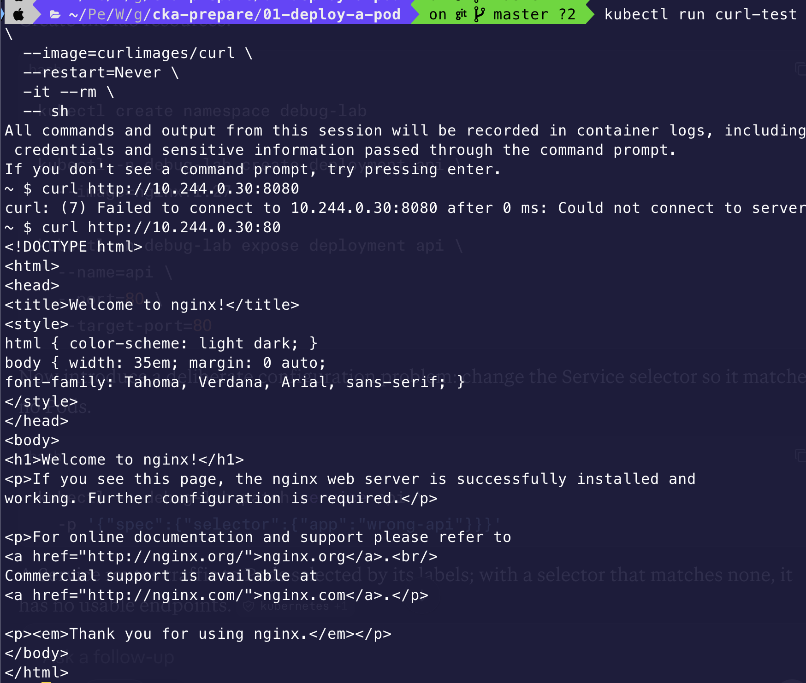
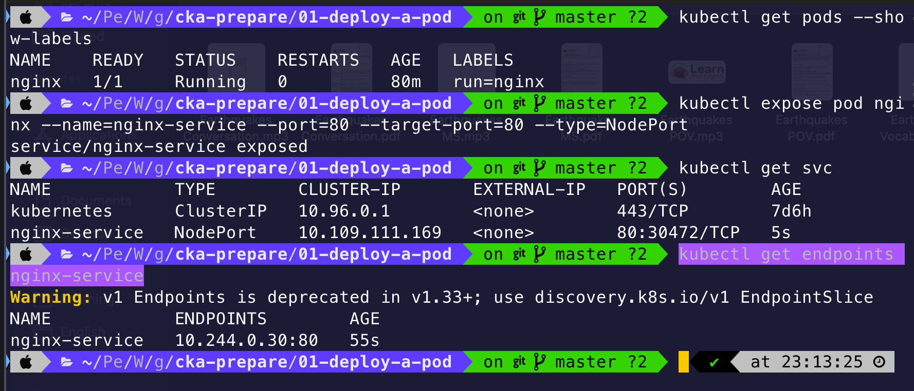
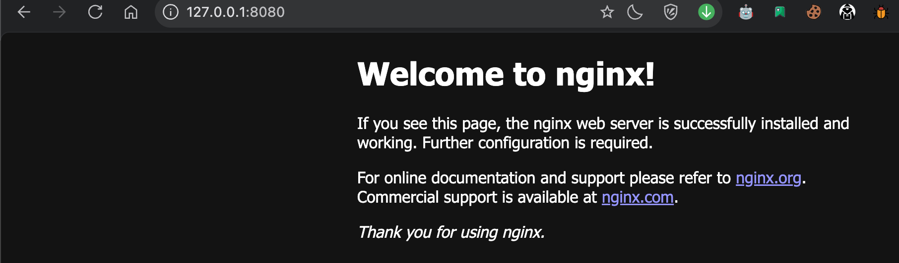
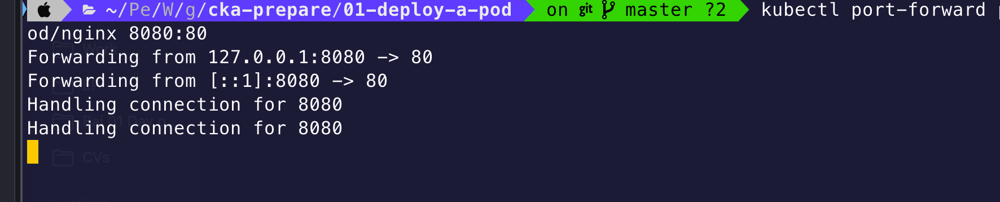

# Deploy pod

## Create yaml and run a pod
- Instead of typing the whole yaml file from scratch. Use `dry-run` command `kubectl run nginx --image=nginx --dry-run=client -o yaml > nginx.yaml`

- And then apply yaml file by `kubectl apply -f nginx.yaml`

  

- Command to force apply changes for a pod `kubectl replace --force -f nginx.yaml`

## Problem

### 1. How to test connectivity with the application running inside a Pod

- **Option 1: Test from inside the K8s cluster**

  + Step 1: Run a temporary Pod with `curl`
  + Step 2: Run curl inside the temporary Pod

  ```shell
  kubectl run curltest --image=curlimages/curl --restart=Never -it --rm -- sh

  curl http://<node-ip>:80
  ```
  
    

- **Option 2: Create a Service for your Nginx Pod**

  + Step 1: Check Pod's name and label (used for selector)
  + Step 2: Create a service that selects the Pod

  ```shell
  # Get label
  kubectl get pods --show-labels

  # Create a NodePort service
  kubectl expose pod nginx --name=nginx-service --port=80 --target-port=80 --type=NodePort

  # Ensure the service's endpoint has this pod
  kubectl get endpoints nginx-service
  ```

    

- **Option 3: port-forward to Mac**

  + Run port-forward command `kubectl port-forward pod/nginx 8080:80`

    

    