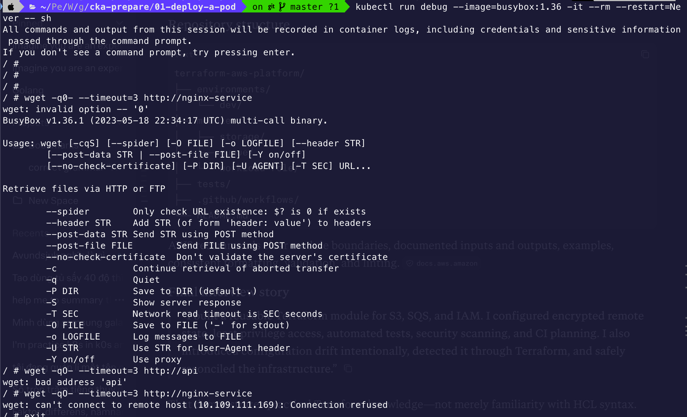
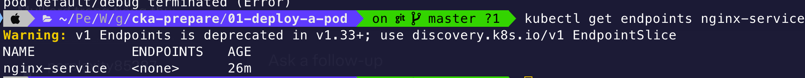
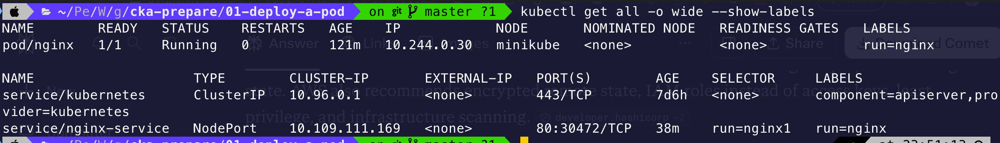

# Problem

- Imagine your team operate a 3-tier web application with `web`, `api` and `db`
- And you are notified that the web application can not reach the api Service

## Debug

- First check if the problem is DNS resolution or Service-to-Pod routing

  + Run busybox Pod to validate DNS working `kubectl run debug --image=busybox --rm -it --restart=Never -- sh`
  
  + And then make HTTP request to internal Service `wget -qO- --timeout=3 http://api` (-0- : send the response body to stdout)

    

  + DNS can resolve the hostname `nginx-service` to IP address -> DNS is working

- Second, check if the Service has healthy backend endpoints `kubectl get endpoints nginx-service`

    

    + Service currently has no backend Pods to send traffic to

- Finally, double-check the Service selector and Pod's label -> there is a mismatch

    