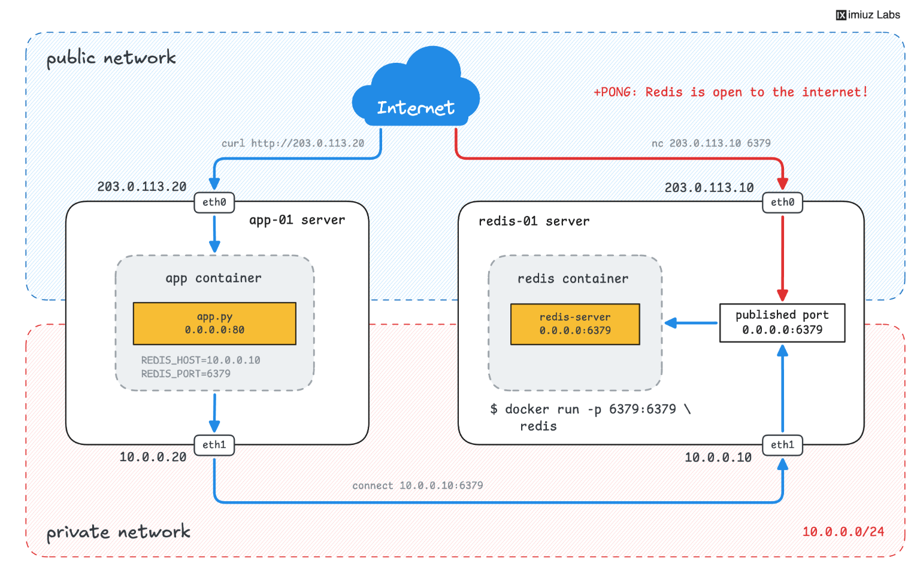

# Publish a container port on a Private IP address

## Problem
- we have 2 servers, each with a public and a private IP.
- with the normal approach, the redis port is reachable via publish network, but we don't want it

- in the upcoming setup, the `app` listens on the public port but want to talk with `redis` over private network

## Goal
- The `app-01` can reach Redis at `10.0.0.10:6379` and the port 6379 at host must not be reachable through the public address `203.0.113.10`
-> keeping a service off the public internet.

## How

- Publish the port including private IP address -> `-p HOST_PRIVATE_IP:6379:6379`
- From the `app` server
  + run `redis-cli -h 10.0.0.10 -p 6379 ping` to verify the connection
  + or use `nc -zv 10.0.0.10 6379` and `nc -zv 203.0.113.10 6379`
