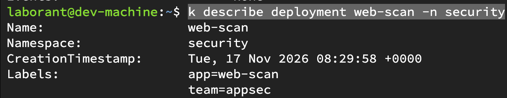

# Identify the Source of Unexpected Requests in a Kubernetes Cluster

## Problem
- An internal service started receiving requests from unexpected IP addresses. Identify the unexpected sources and find out which workloads and teams are behind them.

## Details
- `Inventory` service runs as the `inventory` deployment in the `warehouse` namespace
- Some of its regular clients is `orders` deployment from the `shop` namespace and `uptime-prober` deployment from `monitoring` namespace that polls the `/health` endpoint every few seconds.
- Recently, the `inventory` service has received requests from unexpected pod addresses
-> Find out how is behind the unexpected requests.

## Solution

- First, let check the logs of `inventory` service via `k logs inventory-bbfd948c7-rkttw -n warehouse`
  
  ```shell
  10.42.2.6 - - [17/Nov/2026:09:21:50 +0000] "GET /api/v1/items?page=5 HTTP/1.1" 200 131 "-" "orders-service/2.7.1"
  10.42.0.14 - - [17/Nov/2026:09:21:51 +0000] "GET /api/v1/items/6 HTTP/1.1" 200 48 "-" "orders-service/2.7.1"
  10.42.2.6 - - [17/Nov/2026:09:21:51 +0000] "GET /api/v1/items/25 HTTP/1.1" 200 51 "-" "orders-service/2.7.1"
  ```

- Find unique request and source of request via `k logs inventory-bbfd948c7-rkttw -n warehouse | awk -F'"' '{print $2, $6}' | uniq -c | sort -ur`

  ```shell
  2 GET /wp-login.php HTTP/1.1 python-urllib/3.12
  2 GET /phpmyadmin/ HTTP/1.1 python-urllib/3.12
  2 GET /health HTTP/1.1 uptime-prober/1.0
  2 GET /config.json HTTP/1.1 python-urllib/3.12
  2 GET /backup.zip HTTP/1.1 python-urllib/3.12
  2 GET /api/v1/users HTTP/1.1 python-urllib/3.12
  2 GET /api/v1/items?page=5 HTTP/1.1 orders-service/2.7.1
  2 GET /api/v1/items?page=5 HTTP/1.1 catalog-indexer/0.9.3
  2 GET /api/v1/items?page=4 HTTP/1.1 orders-service/2.7.1
  2 GET /api/v1/items?page=4 HTTP/1.1 catalog-indexer/0.9.3
  2 GET /api/v1/items?page=3 HTTP/1.1 orders-service/2.7.1
  2 GET /api/v1/items?page=3 HTTP/1.1 catalog-indexer/0.9.3
  2 GET /api/v1/items?page=2 HTTP/1.1 orders-service/2.7.1
  2 GET /api/v1/items?page=2 HTTP/1.1 catalog-indexer/0.9.3
  2 GET /api/v1/items?page=1 HTTP/1.1 orders-service/2.7.1
  2 GET /api/v1/items?page=1 HTTP/1.1 catalog-indexer/0.9.3
  2 GET /api/v1/items/54 HTTP/1.1 orders-service/2.7.1
  2 GET /api/v1/items/51 HTTP/1.1 orders-service/2.7.1
  2 GET /api/v1/items/44 HTTP/1.1 orders-service/2.7.1
  2 GET /api/v1/items/15 HTTP/1.1 orders-service/2.7.1
  2 GET /api/v1/items/1 HTTP/1.1 python-urllib/3.12
  2 GET /api/v1/ HTTP/1.1 python-urllib/3.12
  2 GET /api/ HTTP/1.1 python-urllib/3.12
  2 GET /admin/login HTTP/1.1 python-urllib/3.12
  2 GET /admin HTTP/1.1 python-urllib/3.12
  2 GET /.git/config HTTP/1.1 python-urllib/3.12
  2 GET /.env HTTP/1.1 python-urllib/3.12
  ```

    + we can see `/heath` and `/api/v1/items` that are quite usual requests for `inventory` service.
    + But there are lot of requests comes from `python-urllib/3.12` service that call to non-existence endpoint `/wp-login.php`, `/backup.zip`, `/admin/login`...
  
- They don't show any information about the backed services. So let try to get its IP and find the pod related with those IPs via `k logs inventory-bbfd948c7-rkttw -n warehouse | awk '/python-urllib\/3.12/ {print $1}' | sort -u`

  ```shell
  10.42.0.15
  10.42.2.7
  ```

- And these are the related Pods 

  ```shell
  k get pod -A -o wide | grep -i 10.42.0.15
  security      web-scan-9fc8c4b87-k6mdj                  1/1     Running     0             83m   10.42.0.15   cplane-01   <none>           <none>

  security      web-scan-9fc8c4b87-wb778                  1/1     Running     0             86m   10.42.2.7    node-02     <none>           <none>

- Find the in charge team via `k describe deployment web-scan -n security`
  

## NOTE
- We missed these kind of requests 
  ```shell
  10.42.0.16 - - [17/Nov/2026:10:10:00 +0000] "GET /api/v1/items/export?format=csv HTTP/1.1" 404 22 "-" "Wget"
  ```

  ```shell
  10.42.2.8 - - [17/Nov/2026:10:16:16 +0000] "GET /api/v1/items?page=3 HTTP/1.1" 200 131 "-" "catalog-indexer/0.9.3"
  10.42.1.9 - - [17/Nov/2026:10:16:16 +0000] "GET /api/v1/items?page=3 HTTP/1.1" 200 131 "-" "catalog-indexer/0.9.3"
  ```

  + And it comes from `catalog-indexer` statefulSet
  ```shell
  default       export-test                               1/1     Running     0              101m   10.42.0.16   cplane-01   <none>           <none>
  ```