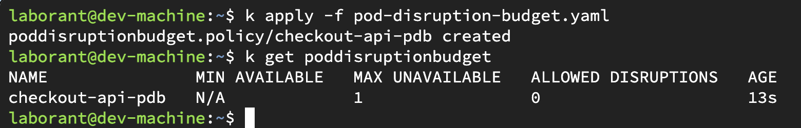
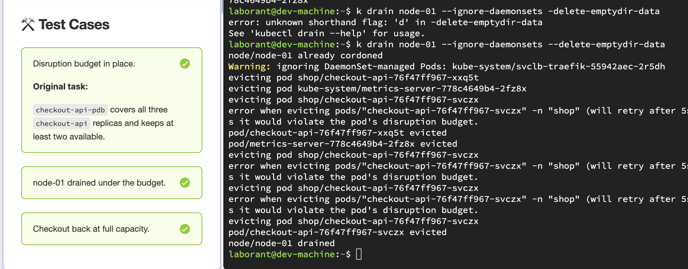

# Safe Node Drain With a Disruption Budget

## Problem
- `checkout-api` service runs in the `shop` namespace. It has 3 replicas and the team's rule is: **checkout never runs on fewer than two**

- And `node-01` is scheduled for a kernel patch tonight. It currently hosts two of the three replicas.

- If `node-01` is drained as normal, two of the three replicas would go down together -> that violates the team rule

## Goal
- Create `PodDisruptionBudget` that keeps at least 2 of the `checkout-api` replicas available.

## How to do
- Follow this link [PDB](https://kubernetes.io/docs/tasks/run-application/configure-pdb/) to understand about Disruption Budget

- And follow the PDP sample to create manifest file 
  ```pod-disruption-budget.yaml
  apiVersion: policy/v1
  kind: PodDisruptionBudget
  metadata:
    name: checkout-api-pdb
    namespace: shop
  spec:
    maxUnavailable: 1
    selector:
      matchLabels:
        app: checkout-api
  ```

  + make sure to get the correct label for selector

  

- Drain node via ` drain node-01 --ignore-daemonsets --delete-emptydir-data`

