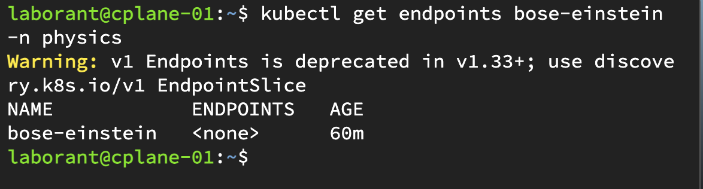
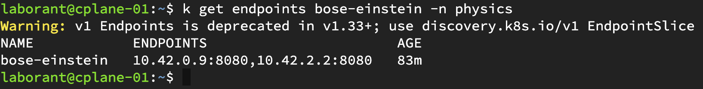
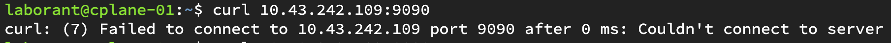
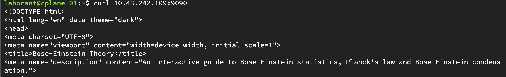
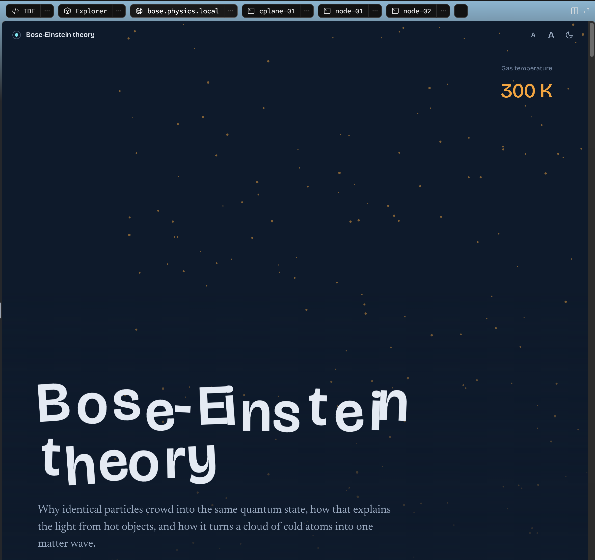

# Ingress that returns 404 not found

## Problem
- The `bose-einstein` deployment run nginx in the `physics` namespace. It is exposed through `bose-einstein` ingress at `http://bose.physics.local` but the address return 404 error.

- `nginx` in the Pods is heathy and listens on port 9090. And there are misconfigurations in `ingress.yaml` and `service.yaml`
-> Detect and fix them

## How

- First, let look at those manifest files

  ```yaml
  # Deployment.yaml
  apiVersion: apps/v1
  kind: Deployment
  metadata:
    name: bose-einstein
    namespace: physics
  spec:
    replicas: 2
    selector:
      matchLabels:
        app: bose-einstein
    template:
      metadata:
        labels:
          app: bose-einstein
          tier: frontend
      spec:
        containers:
        - name: nginx
          image: nginx:1.29-alpine
          ports:
          - containerPort: 9090
          readinessProbe:
            httpGet:
              path: /
              port: 9090
            periodSeconds: 5
          volumeMounts:
          - name: site
            mountPath: /usr/share/nginx/html
          - name: nginx-conf
            mountPath: /etc/nginx/conf.d
        volumes:
        - name: site
          configMap:
            name: bose-einstein-site
        - name: nginx-conf
          configMap:
            name: bose-einstein-nginx
  ```

  ```yaml
  # ingress.yaml
  apiVersion: networking.k8s.io/v1
  kind: Ingress
  metadata:
    name: bose-einstein
    namespace: physics
  spec:
    ingressClassName: traefik
    rules:
    - host: bose.physics.local
      http:
        paths:
        - path: /
          pathType: Prefix
          backend:
            service:
              name: bose-einstein
              port:
                number: 80

  # service.yaml
  apiVersion: v1
  kind: Service
  metadata:
    name: bose-einstein
    namespace: physics
  spec:
    type: ClusterIP
    selector:
      app: bose-einstein
      tier: front-end
    ports:
    - port: 9090
      targetPort: 8080
  ```

- Let check the service endpoint to see if there is any problem `kubectl get endpoints bose-einstein -n physics`

    

  + There is no endpoint for `bose-einstein` service. And it seems there is a mismatch in pod selector label. `front-end` and `frontend`
  -> Let update and see the result

    

- Try to connect with ClusterIP service to see if there is any error -> failed to connect to backend server. 
    

    + The problem is we defined the wrong targetPort in service. `nginx` pod listen on port `9090` instead of `8080` -> we now can see the response after updating the port

      

- The ingress route traffic from the frontend to the correct service name but with the wrong port `80` instead of service's exposed port `9090` -> Let fix and see the result -> we can see the UI now

    

## Note

- Ingress `backend.service.port` is a port of the service
- Service `port` is the port the service expose
- Service `targetPort` is the port the container listens on