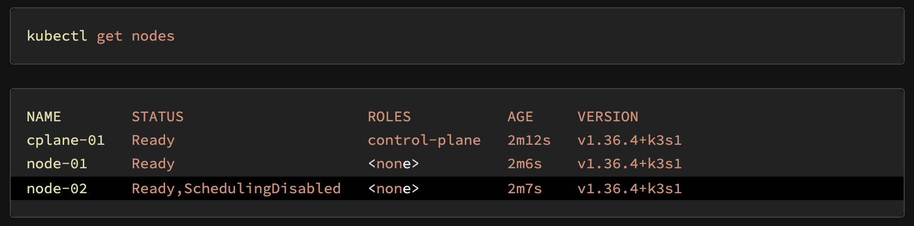
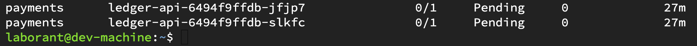
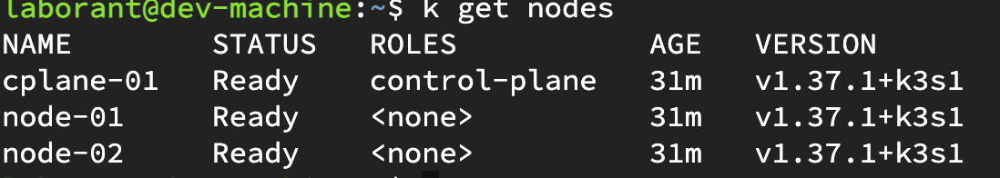
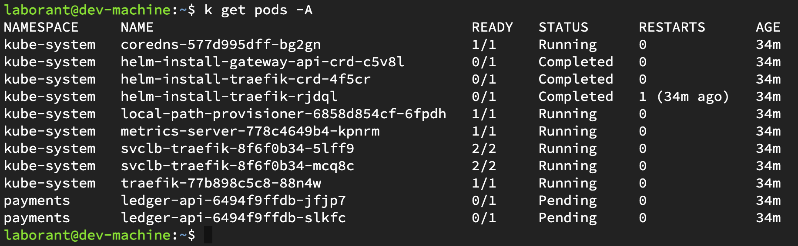
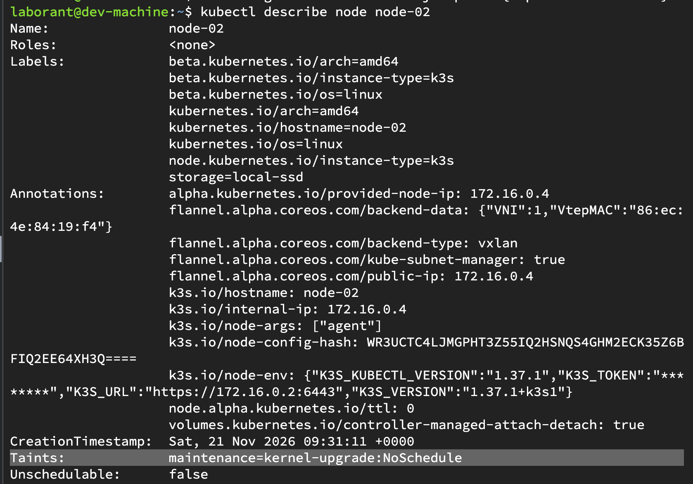
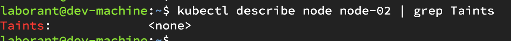

# Node is ready, but pods won't schedule

## Problem
- `node-02` is back from a kernel upgrade, but still show `Ready,SchedulingDisabled`.
    

- the Pods that can only run on it are stuck in Pending. 
    

## How to solve
- The Node is not available for scheduling, maybe, the reason is the Node isn't `uncordon`. Let try to see if it fix the problem -> it's now available for scheduling

    

- But the pod is still in `Pending` state

    

  + Let describe the node and see if there is any problem -> There is a `Taints` that prevent the normal Pods to be scheduled (**only Pod that has a matching Toleration)
      - **Pods already running on the node will continue running**

    

      - One solution is is adding a toleration to the Pod specification

        ```shell
        spec:
          tolerations:
            - key: "maintenance"
              operator: "Equal"
              value: "kernel-upgrade"
              effect: "NoSchedule"
        ```

      - Or remove the taint using this command `kubectl taint nodes <node-name> maintenance=kernel-upgrade:NoSchedule-` -> Now Node has no Taints and Pods can be scheduled in this node

          
