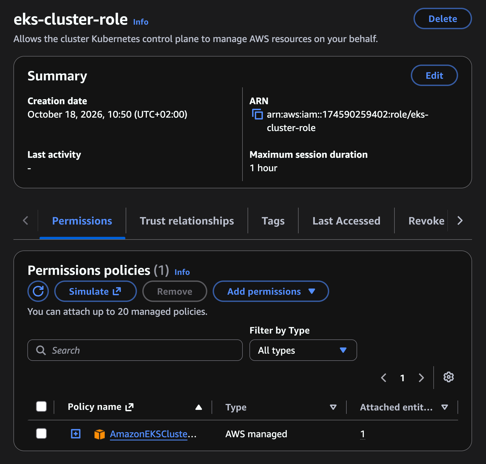

# Create IAM Role for EKS cluster

## 1. Goal
- Create IAM role with proper Policy
- Assign this role to EKS cluster managed by AWS -> to allow AWS to create and manage components on our behalf.

## 2. Steps

- Go to IAM and select `Create Role`
- Set trusted entity type `AWS service`
- Select `EKS - Cluster` as Service (_AWS will automatically assign the necessary policy for this role - `AmazonEKSClusterPolicy`_)
- Set Role name and select `Create role`

  