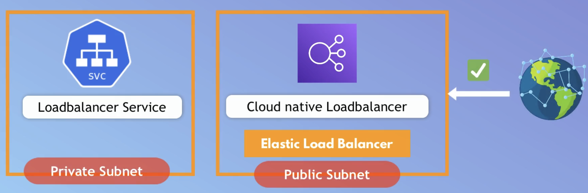
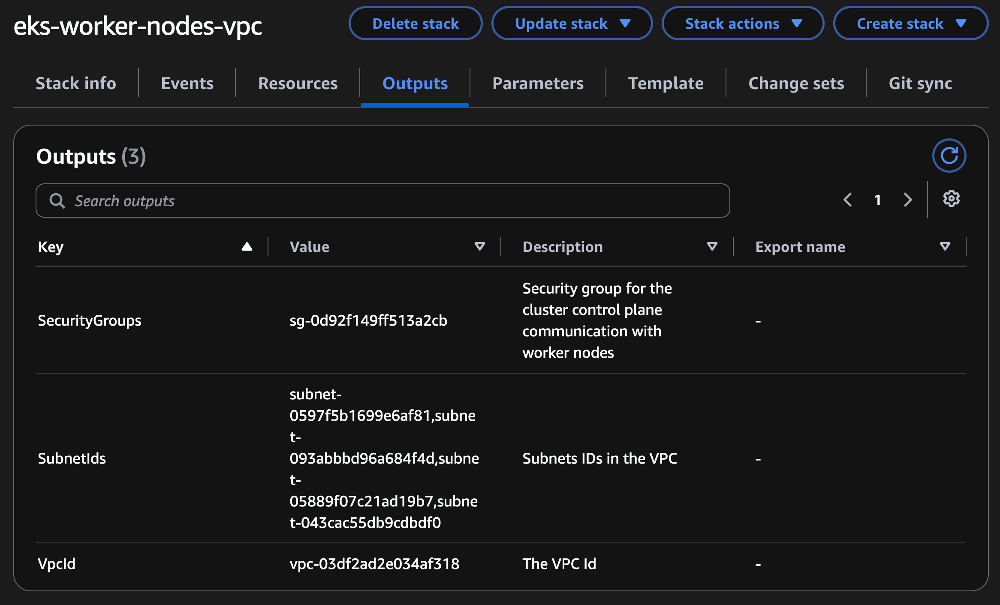

# Create VPC for Worker Nodes

## 1. Goal
- Create VPC for worker nodes with specific Firewall configurations
- Allow communication between Control Plane's VPC with Worker Nodes's VPC
- Configure Public/Private subnets

  

## 2. Steps

- Use `Cloud Formation template` to create the whole stacks for VPC
  + Link: [VPC-template](https://docs.aws.amazon.com/eks/latest/userguide/creating-a-vpc.html)

- These information will be used when creating the EKS cluster (Control Plane)
  
  