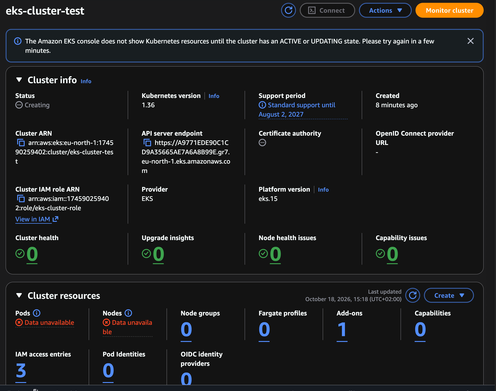
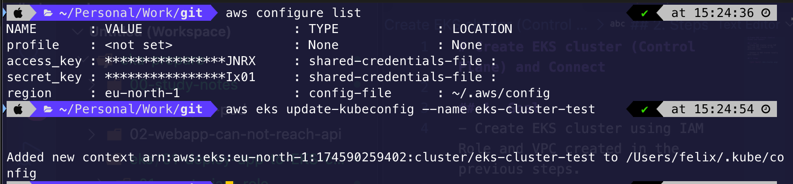
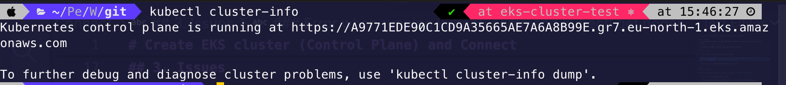
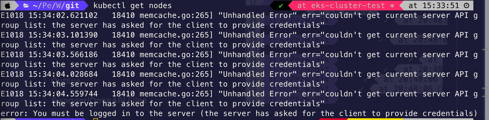

# Create EKS cluster (Control Plane) and Connect 

## 1. Goal
- Create EKS cluster using IAM Role and VPC created in the previous steps.

- Connect to EKS cluster locally with kubectl.

## 2. Steps

- Create EKS cluster using `auto mode`
  

- Update kubeconfig file to connect to eks cluster `aws eks update-kubeconfig --name eks-cluster-test`

  

- Now, kubectl can connect to API server endpoint
  
  


## 3. Issues

### Error when running kubectl command `kubectl get nodes`

  

  - The problem was that EKS dit not yet grant this IAM user permission to access Kubernetes
    
    ```shell
    aws sts get-caller-identity
    ...
    "Arn": "arn:aws:iam::174590259402:user/Thanh"
    ```

  - Solution:
    + Provide permission to access cluster
      ```shell
      aws eks create-access-entry \
      --cluster-name eks-cluster-test \
      --principal-arn arn:aws:iam::174590259402:user/Thanh \
      --region eu-north-1
      ```

    + Attach EKS Admin policy, so that I can read/create/update resources

      ```shell
      aws eks associate-access-policy \
      --cluster-name eks-cluster-test \
      --principal-arn arn:aws:iam::174590259402:user/Thanh \
      --policy-arn arn:aws:eks::aws:cluster-access-policy/AmazonEKSClusterAdminPolicy \
      --access-scope type=cluster \
      --region eu-north-1
      ```