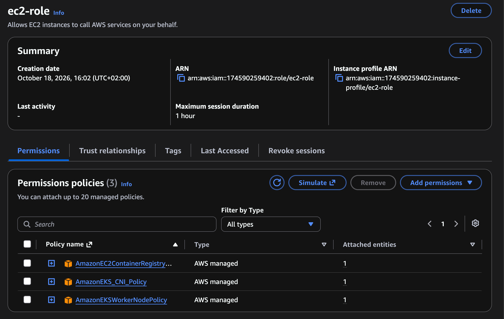

# Create Node Group and attach to EKS cluster

## 1. Goal
- Create EC2 Role for Node Group (worker nodes)

- Create Node Group with that EC2 role

- Attach this Node Group to EKS cluster

## 2. Steps

- Worker Nodes run `worker processes` and `kubelet` is the main process - scheduling, managing Pods and communicate with other AWS services
  -> `Kubelet` needs permission

- Create a new role for EC2 service (because kubelet run on EC2) with these policy:
  + `AmazonEC2ContainerRegistryReadOnly` - allow EC2 to interact with ECR
  + `AmazonEKS_CNI_Policy` - allow VPC CNI interact with worker nodes
  + `AmazonEKSWorkerNodePolicy` - allow nodes to connect to EKS cluster

      

- Inside cluster dashboard, choose Cluster resources -> Add node group (remember to use EC2 IAM role created in previous step)
  + With Node Group all necessary processes are installed (_containerd, kubelet, kube-proxy_)

    