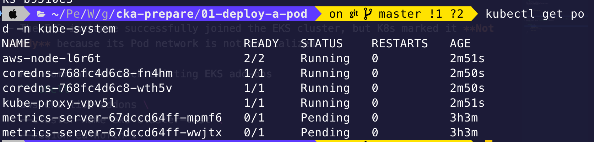
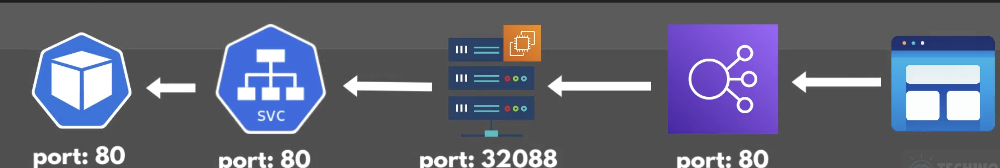
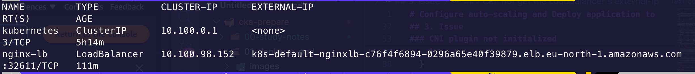
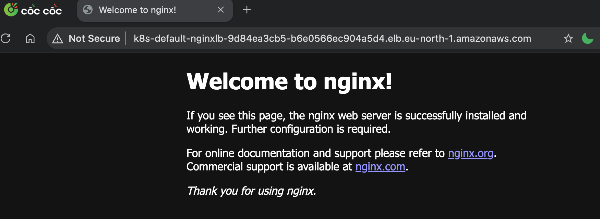

# Configure auto-scaling and Deploy application to EKS cluster

## 1. Goal
- Configure auto-scaling for EKS cluster using Node group
  + Trade off: save costs but provisioning a new EC2 instance takes time

- Deploy application to EKS cluster

## 2. Steps

- Auto Scaling Group (ASG) is mainly the capacity controller for EC2 instances. But the instruction to change capacity can come from different places.
  + K8s cluster autoscaler
  + CloudWatch alarm
  + Scheduling scaling (_a predefined schedule tells the ASG to scale up before an expected traffic peak_)
  + A person (_manually changes desired capacity_)

- Example:
  + Pod pending because no node has enough CPU -> Cluster autoscaler detects the problem -> trigger ASG to scale -> ASG creates EC2 instance -> new instance joins EKS as a node -> K8s scheduler places the pending Pod to new Node.

- Flow
  + Create auto scaling group
  + Create custom policy and attach to Node Group IAM Role
    - Attach IAM autoscaling policy to EC2 Node group role 
    - link: [policy](https://github.com/kubernetes/autoscaler/blob/master/cluster-autoscaler/cloudprovider/aws/README.md)

  + Deploy K8s Autoscaler via yaml file 
    - link : [autoscaler](https://github.com/kubernetes/autoscaler/blob/master/cluster-autoscaler/cloudprovider/aws/examples/cluster-autoscaler-autodiscover.yaml)

  

- Deploy Nginx app with Cloud Load Balancer
  + [deployment](./nginx.yaml)
  + [service](./nginx-lb-svc.yaml)

  

  

  

## 3. Issue
### 3.1 Can not create node group with t3.nano
```shell
Could not launch On-Demand Instances. InvalidParameterCombination - The specified instance type is not eligible for Free Tier. For a list of Free Tier instance types, run 'describe-instance-types' with the filter 'free-tier-eligible=true'. Launching EC2 instance failed.
```
- The reason is t3.nano is not eligible for Free Tier. Use this command to see which instance types qualify for your account 
  ```shell
  aws ec2 describe-instance-types \
  --region eu-north-1 \
  --filters Name=free-tier-eligible,Values=true \
  --query "InstanceTypes[*].InstanceType" \
  --output text | tr '\t' '\n' | sort
  ```

- Move to t3.micro or t3.small

### 3.2 CNI plugin not initialized

```shell
ip-192-168-178-108.eu-north-1.compute.internal
Disabled
Ready
container runtime network not ready: NetworkReady=false reason:NetworkPluginNotReady message:Network plugin returns error: cni plugin not initialized
```

- The EC2 instance successfully joined the EKS cluster, but K8s marked it **Not Ready** because its Pod network is not initialized

- Run command to check existing EKS add-ons
  ```shell
  aws eks list-addons \
  --cluster-name eks-cluster-test \
  --region eu-north-1

  {
    "addons": [
        "metrics-server"
    ]
  }
  ```
  -> it lacks vpc-cni, kube-proxy and coredns

- Solution: go to `Add-ons page` and select `VPC CNI, CoreDNS and kube-proxy`
- Double-check with `list-addons` command
  ```shell
  {
    "addons": [
        "coredns",
        "kube-proxy",
        "metrics-server",
        "vpc-cni"
    ]
  }
  ```

### 3.3 Can not get the LoadBalancer's external-ip

- We created a service with LoadBalancer type, but still not saw its external-ip 
  ```shell
    Warning  FailedBuildModel  15m   service  Failed build model due to operation error EC2: CreateSecurityGroup, get identity: get credentials: failed to refresh cached credentials, operation error STS: AssumeRole, https response error StatusCode: 403, RequestID: d236aad9-72a0-4fa2-b960-a706c5ce003e, api error AccessDenied: User: arn:aws:sts::061039774932:assumed-role/EKSNetworkingChainRole/eks-auto-mode-loadbalancing-0806ce9f74185affee8b is not authorized to perform: sts:TagSession on resource: arn:aws:iam::174590259402:role/eks-cluster-role
  ```

- The problem is EKS cluster attempts to assume eks-cluster-role with session tags. But trust policy does not allow sts:TagSession.
  + [Check for an existing cluster role](https://docs.aws.amazon.com/eks/latest/userguide/auto-cluster-iam-role.html)

### 3.4 Can not access via LB's external IP

```shell
curl -v --connect-timeout 5 --max-time 15 \
  http://k8s-default-nginxlb-c76f4f6894-0296a65e40f39879.elb.eu-north-1.amazonaws.com
* Host k8s-default-nginxlb-c76f4f6894-0296a65e40f39879.elb.eu-north-1.amazonaws.com:80 was resolved.
* IPv6: (none)
* IPv4: 192.168.138.112
*   Trying 192.168.138.112:80...
* ipv4 connect timeout after 4955ms, move on!
* Failed to connect to k8s-default-nginxlb-c76f4f6894-0296a65e40f39879.elb.eu-north-1.amazonaws.com port 80 after 5003 ms: Timeout was reached
* Closing connection
curl: (28) Failed to connect to k8s-default-nginxlb-c76f4f6894-0296a65e40f39879.elb.eu-north-1.amazonaws.com port 80 after 5003 ms: Timeout was reached
```

- First, run some commands to verify if it work inside K8s
  ```shell
  kubectl get pods -o wide
  kubectl get endpoints nginx-lb
  kubectl describe pod <pod_name>
  kubectl describe svc nginx-lb
  kubectl run curl-test --image=curlimages/curl -it --rm --restart=Never -- curl http://nginx-lb
  ```

- Based on the above log, DNS name resolved to `192.168.138.112` -> this is private VPC IP address -> Your NLB is internal
  + Run command to update the scheme to `internet-facing`

  ```shell
  kubectl annotate service nginx-lb \
  service.beta.kubernetes.io/aws-load-balancer-scheme=internet-facing \
  --overwrite
  ```