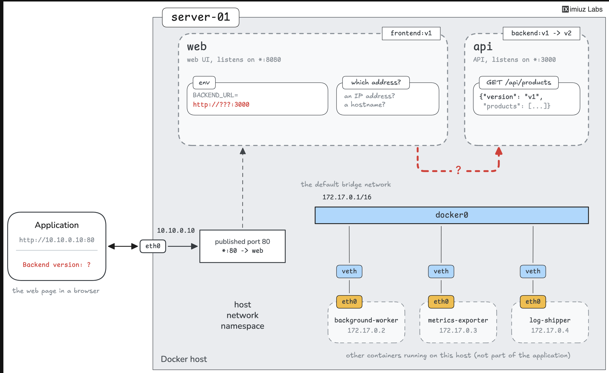
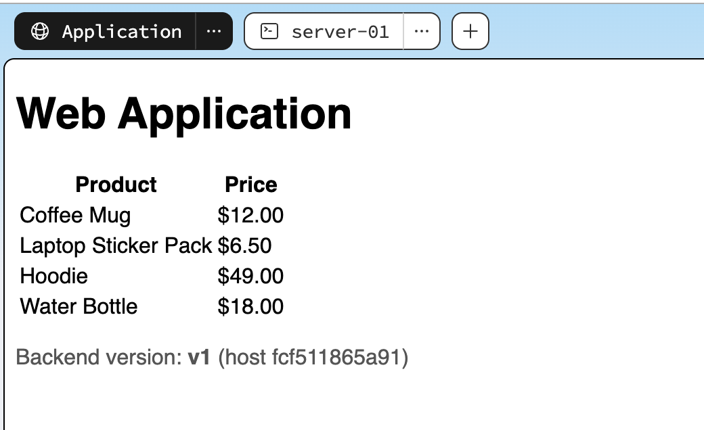

# Launch a Multi-Container Web Application, Then Upgrade Its Backend

> **NOTE**
>
> **Port forwarding** is a mechanism that redirects network traffic arriving at one IP address and port to another IP address and port.


## Information

- `frontend` - it listens on port 8080 and fetches products from URL specified by `BACKEND_URL` env (_http://ADDR:PORT_)

- `backend` - it listens on port 3000

    

## Problem

### Deploy the application
- Requirement: 
  + Start the `frontend:v1` and `backend:v1` containers and make the frontend available on port 80 of `server-01`. The Application page should display the products served by backend v1.

  + The only requirement is that the web UI is accessible from outside the Docker host - the backend doesn't need to be exposed.


- Solution:
  + By default, docker attaches new container to a network called `bridge` -> containers on this network can communicate directly using their IP address (**no port publishing or extra network**)

  + So, we run the `backend` container first, get its IP and set the env variable when running the `frontend` container

  ```shell
  docker run -d --name backend backend:v1 # run backend container

  docker inspect backend # to get container's IP address

  docker run -d --name frontend -p 10.10.0.10:80:8080 -e BACKEND_URL=http://172.17.0.5:3000 frontend:v1 # run frontend container
  ```

  

- TIP
  + The container's IP address can change when containers are recreated -> **a better approach is to create Docker network**

  ```shell
  docker network create mynetwork

  docker run -d --name backend --network mynetwork backend:v1 # connect backend

  docker run -d \
  --name frontend \
  --network mynetwork \
  -p 10.10.0.10:80:8080 \
  -e BACKEND_URL=http://backend:3000 \
  frontend:v1 # access backend via container's name
  ```

  + So, the connection URL is unchanged even we rollback/rollout new backend version