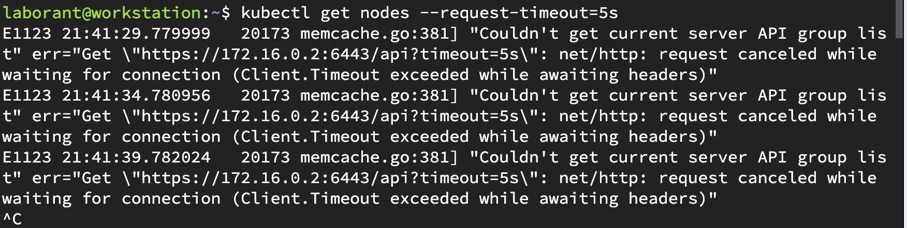
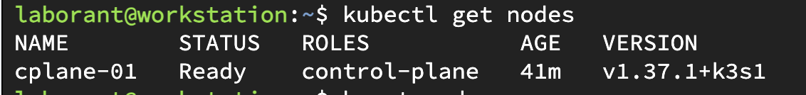
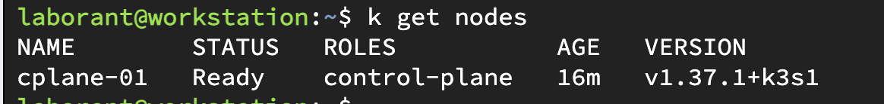

# Access a Private Kubernetes API Server Inside a Private VPC

## Information
- The production k8s cluster runs inside a private VPC
- Its API server has no public endpoint. 
- Control-plane node listens on `172.16.0.2:6443` - only reachable inside VPC
- You have admin credentials in `~/.kube/config` but your workstation has **no route into the VPC**
- There is a public-facing bastion that you can SSH into, and it's connected to VPC

## Problem
- Find a way to connect to API server via Bastion host
## Solution

### 1. Use SSH local port forwarding and rewrite the server in .kube/config

- Step 1: `ssh -L 6443:172.16.0.2:6443 laborant@203.0.113.20` --> create a secure tunnel from a port on your own computer to a private server through the bastion
    

- Step 2: Update the `.kube/config` file

    ```shell
    server: https://localhost:6443 # Where is K8s API server
    tls-server-name: 172.16.0.2 # use this when validate server's identity, instead of using server's value
    certificate-authority-data # root CA certificate used to validate server's identity

    client-certificate-data # certificate to prove identity of user
    client-key-data # private key 
    ```

    

### 2. Use SSH dynamic port forwarding (a SOCKS5 Proxy) to Access the Kubernetes API

- Useful when the cluster you want to access does not expose its API directly on the public internet.

- First, create a SOCKS that proxy request from localhost to bastion via `ssh -N -D 1080 laborant@203.0.113.20` -> don't close this session
  + `-N` : don't run shell in bastion, only create tunnel
  + `-D 1080` create a SOCKS proxy listening on port 1080

- Second, to always use this setting on a specific kubectl context, set `proxy-url: socks5://localhost:1080` in `~/.kube/config` file

  

## NOTE

- `Bastion host` is a hardened server that acts as an entry point from external network (internet) into a private internal network
  - reduce attach surface
  - has strong authN/authZ mechanism and audit logs


- `SSH - 22` is a network protocol that allow you to **securely connect and communicate** with another computer over unsecured network (e.g, internet)
  + `remote login/administration` : give you a secure interactive shell on a remote server
  + `port forwarding` : creates encrypted tunnels that send network traffic from  one port/machine to another port/machine

- `local port forwarding` open a port on my computer and forward traffic through SSH to a destination
 + `ssh -L 6443:172.16.0.2:6443 laborant@203.0.113.20`
 + `laborant@203.0.113.20` : SSH server
 + `172.16.0.2:6443` : destination server as seen from the SSH server
 + `6443` : port on your local host

- `remote port forwarding` open a port on the SSH server and forward traffic back through SSH to a destination on my side (_e.g., you want a remote server to be able to access your local service_)
  + `ssh -R 8080:localhost:3000 user@server`
  + `8080` is a remote port

- `dynamic port forwarding` create a SOCKS proxy on my computer that sends traffic through SSH (_you don't specify destination port in advance - various destinations_)
  + `ssh -D 1080 user@server`
  + `SOCKS proxy` act as the server in between source/destination server, receive/forwards request and sends the responses back. Your application doesn't connect directly to the destination.