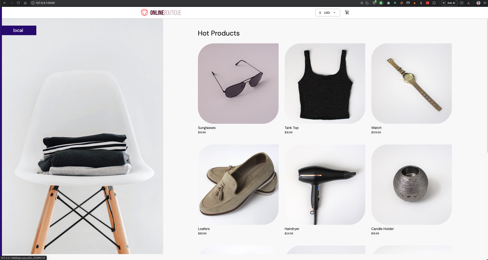
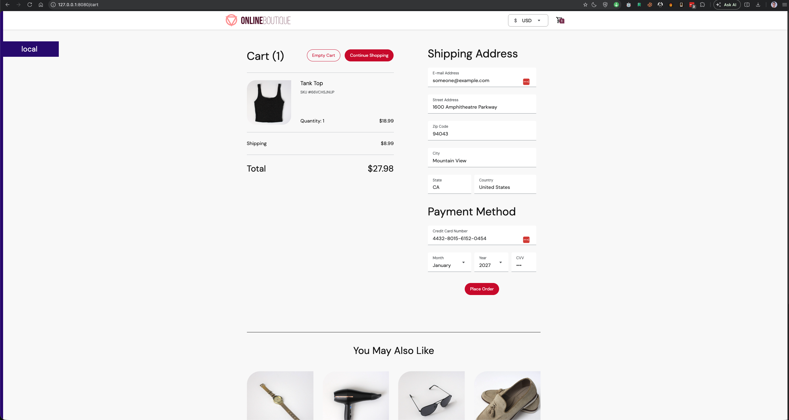

# Online Boutique Shop on Kubernetes

This repository packages Google's [Online Boutique microservices demo](https://github.com/GoogleCloudPlatform/microservices-demo) for Kubernetes. It includes a reusable Helm chart for the application services, a dedicated Redis chart, and two ways to deploy them.

## Chart Structure

```text
online-boutique-shop/
├── Chart.yaml                 # Umbrella chart metadata and dependencies
├── charts/
│   ├── microservice/          # Reusable chart for core application services
│   └── redis/                 # Dedicated Redis chart
├── helmfile.yaml              # Independent Helm releases
├── scripts/
│   ├── install-services.sh    # Install independent releases with Helm
│   └── uninstall-services.sh  # Remove those releases
└── values/
    ├── <service>.yaml         # Values for each standalone service release
    ├── redis-cart.yaml        # Standalone Redis values
```

The `microservice` chart supplies shared Deployment and Service templates. Each values file configures one service's image, ports, environment, and Service type. Redis uses its own chart because its container and storage configuration differ from the application services.

## Deployment

Helmfile installs Redis and every core service as an independent Helm release. This is useful when you want to upgrade or remove a service on its own. Install Helm and Helmfile first, then run from the repository root:

```sh
helmfile -f ./online-boutique-shop/helmfile.yaml sync
```

To target a namespace other than `default`:

```sh
helmfile -f ./online-boutique-shop/helmfile.yaml \
  --namespace online-boutique sync
```

The equivalent helper script uses Helm directly and accepts the namespace as its first argument:

```sh
./online-boutique-shop/scripts/install-services.sh
./online-boutique-shop/scripts/install-services.sh online-boutique
```

Remove the Helmfile-managed releases with:

```sh
helmfile -f ./online-boutique-shop/helmfile.yaml destroy
```

Or remove the releases installed by the helper script with:

```sh
./online-boutique-shop/scripts/uninstall-services.sh
./online-boutique-shop/scripts/uninstall-services.sh online-boutique
```

## Access the Frontend

The frontend Service is configured as a NodePort on `32000`. With Minikube, get a browser-accessible URL using:

```sh
minikube service frontend --url
```

Alternatively, forward the Service to local port `8080`:

```sh
kubectl port-forward service/frontend 8080:8080
```

Then open <http://localhost:8080>. Add `-n <namespace>` to `kubectl` commands if you deployed into a non-default namespace.



