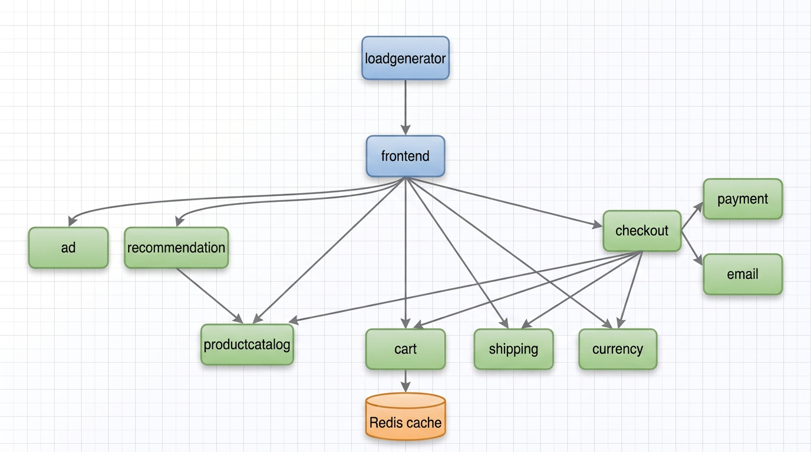
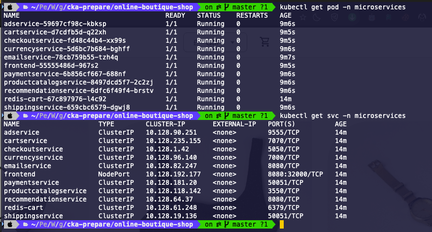
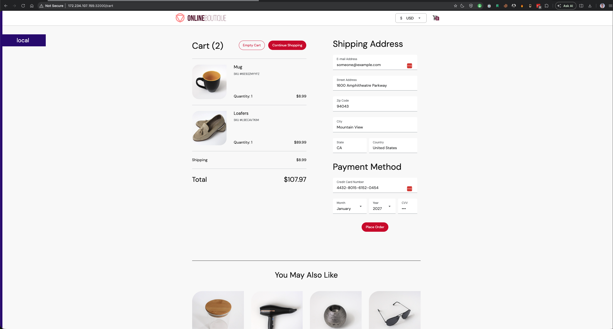
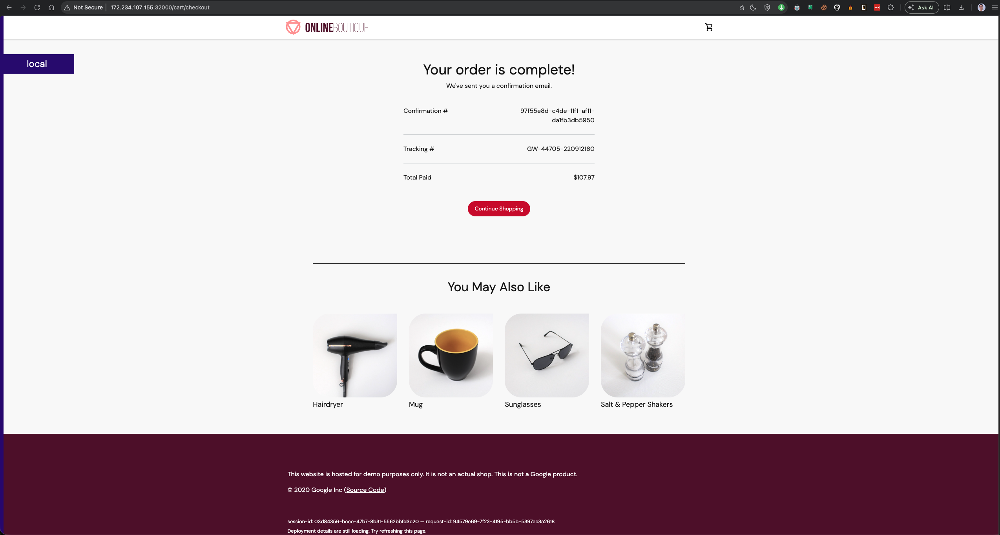

# Online Boutique Shop on Kubernetes

This project deploys a small online store to a Kubernetes cluster using the
manifest in [`online-shop-config.yaml`](online-shop-config.yaml). The workloads
are based on [`Google's Online Boutique microservices demo`](https://github.com/GoogleCloudPlatform/microservices-demo) 

## What's Included

The application is split into services that communicate over Kubernetes
Services:

- `frontend` serves the store's web interface.
- `checkoutservice` coordinates checkout with cart, product catalog, currency,
	shipping, email, and payment services.
- `cartservice` stores cart data in `redis-cart`.
- `productcatalogservice` provides the product catalog.
- `recommendationservice` and `adservice` provide product recommendations and
	advertisements.
- `currencyservice`, `shippingservice`, `emailservice`, and `paymentservice`
	provide supporting checkout functions.

Most services are exposed internally as `ClusterIP` Services. The frontend is
exposed as a `NodePort` on port `32000`.



## Prerequisites

- A running Kubernetes cluster ( I used Linodes cloud provider)
- `kubectl` installed and configured to use that cluster

## Deploy

From this directory, apply the manifest:

```sh
kubectl apply -f online-shop-config.yaml
```

Check deployment and pod status:

```sh
kubectl get deployments
kubectl get pods
kubectl get services
```

Wait for the frontend deployment to become ready:

```sh
kubectl rollout status deployment/frontend
```



## Open the Store

For a cluster that exposes node ports, open `http://<node-ip>:32000`, replacing
`<node-ip>` with the address of a cluster node. The cluster network must allow
access to that port.





