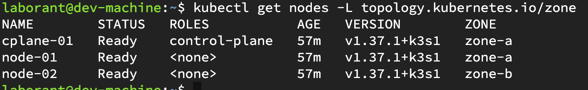
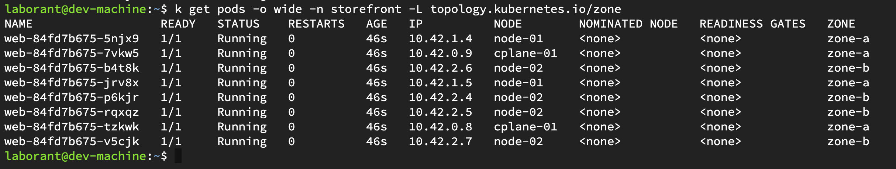

# Split a deployment evenly across two zones

## Problem
- a `storefront` deployment needs eight replicas, and the platform team wants them split down the middle between the two availability zones -> an uneven split must be refused by the scheduler

## How to solve
- First, let check the cluster information and see which zone does the node belongs to via `k get nodes -L topology.kubernetes.io/zone`

  

  + So we need 4 Pods in `zone-a` and 4 in `zone-b`

- [topology-spread-constraints](https://kubernetes.io/docs/concepts/scheduling-eviction/topology-spread-constraints/)

  + Sample definition
  ```shell
  apiVersion: v1
  kind: Pod
  metadata:
    name: example-pod
  spec:
    # Configure a topology spread constraint
    topologySpreadConstraints:
    - maxSkew: 1  # the degree to which Pods may be unevenly distributed
      topologyKey: kubernetes.io/hostname # the key of node labels - divide the node into groups
      whenUnsatisfiable: DoNotSchedule # how to deal with a Pod if it doesn't satisfy constraint
      labelSelector:
        matchLabels:
          app: foo  # find matching Pods
    ### other Pod fields go here
  ```

- Let try to add this `topologySpreadConstraint` to deployment definition and create
  
  ```shell
  apiVersion: apps/v1
  kind: Deployment
  metadata:
    labels:
      app: web
    name: web
    namespace: storefront
  spec:
    replicas: 8
    selector:
      matchLabels:
        app: web
    strategy: {}
    template:
      metadata:
        labels:
          app: web
      spec:
        containers:
        - image: nginx:alpine-slim
          name: nginx
          resources: {}
        topologySpreadConstraints:
        - maxSkew: 1
          topologyKey: topology.kubernetes.io/zone
          whenUnsatisfiable: DoNotSchedule
          labelSelector:
            matchLabels:
              app: web
  status: {}
  ```

- Let check the result, all replicas are scheduled evenly
  