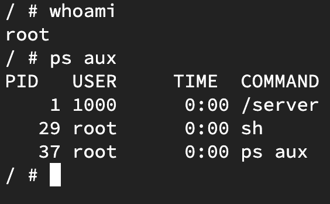
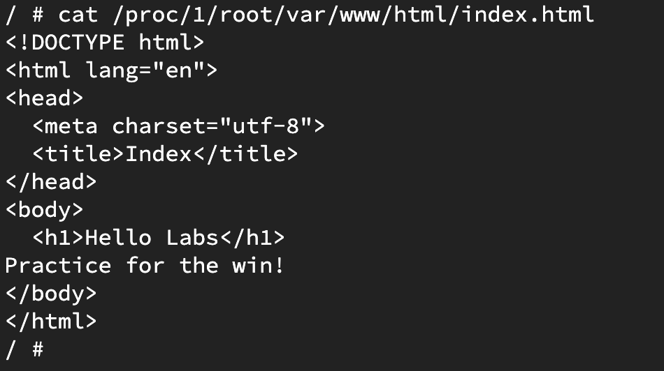

# Edit a file in a running Pod when the container's user has no write access

## Information
- Pod `web-server` in the `default` namespace that serves static file from `/var/www/html` on port 8080. 
- Your task is to edit the `/var/www/html/index.html` in the container without restarting the `app` container or recreating the Pod
  + Replace `Hello World` to `Hello Labs`
  + Add `Practice for the win!` anywhere in the file

## Solution
- kubectl doesn't allow us to run `exec` or `cp` command with root user. So, a trick is run a ephemeral container in the same Pod and use `--target` option so that it can ee processes of one target container.

  ```shell
  kubectl debug -it pod/web-server \
  -n default \
  --target=app \
  --image=busybox:1.36 \
  -- sh
  ```

- After that, you now act as a `root` user in ephemeral container. And you can see the PID of process running in `app` container
    

- Now, you can edit the file via `/proc/1/root/var/www/html/index.html`

    